<div align="center">

# LedgerLine — Secure Simulated Banking & Double-Entry Ledger Platform

**Money movement with a ledger you can prove.**

[Live app](https://ledger-line-umber.vercel.app/) · [API health](https://ledgerline-z5o2.onrender.com/api/health) · [Deployment guide](docs/DEPLOYMENT.md) · [API reference](docs/API.md) · [Threat model](THREATS.md)


</div>

> ⚠️ **Simulated money only.** LedgerLine is a learning and demonstration project. It is not a bank, holds no licence, and is not
> connected to any bank or payment gateway. Never enter real personal or financial data.


---

## Contents

1. [Overview](#1-overview) · 2. [Live application](#2-live-application) · 3. [UI preview](#3-ui-preview) · 4. [Key features](#4-key-features) ·
5. [Technology stack](#5-technology-stack) · 6. [System architecture](#6-system-architecture) · 7. [Banking and ledger design](#7-banking-and-ledger-design) ·
8. [Database schema](#8-database-schema) · 9. [Security architecture](#9-security-architecture) · 10. [Roles and demo experience](#10-roles-and-demo-experience) ·
11. [Testing and verification](#11-testing-and-verification) · 12. [Local setup](#12-local-setup) · 13. [Environment variables](#13-environment-variables) ·
14. [Deployment](#14-deployment) · 15. [API endpoints](#15-api-endpoints) · 16. [Known limitations](#16-known-limitations) ·
17. [Demo credentials](#17-demo-credentials) · 18. [Project highlights](#18-project-highlights) · 19. [Project documentation](#19-project-documentation)

---

## 1. Overview

LedgerLine is a full-stack banking simulation. **Account holders** open accounts and deposit, withdraw and transfer simulated
Indian rupees; **administrators** manage users, staff and accounts; **auditors** inspect everything read-only.

Moving money looks simple — subtract here, add there — but real systems fail in subtle ways:

| Failure | Example | How LedgerLine prevents it |
|---|---|---|
| **Duplicates** | The response to a transfer is lost; the user retries and pays twice | Idempotency keys claimed inside the money transaction |
| **Races** | ₹800 and ₹700 are withdrawn from a ₹1,000 account at the same moment | Row-level locks + a database `CHECK` on the balance |
| **Partial writes** | The server crashes after debiting one account but before crediting the other | One PostgreSQL transaction – all or nothing |
| **Silent tampering** | A balance or history row is changed directly in the database | Append-only triggers, deferred balance checks, hash-chained audit log |

Every movement is recorded as a **double-entry ledger** transaction — one debit and one credit of the same amount — so every balance
can be recomputed from history and **all balances always sum to ₹0**. The most important rules are enforced by **PostgreSQL itself**,
not only by application code, and each of them is proven by automated tests (including tests that deliberately break a safeguard
to show the tests notice).

## 2. Live application

| | URL |
|---|---|
| Frontend (Vercel) | <https://ledger-line-umber.vercel.app/> |
| Backend API (Render) | <https://ledgerline-z5o2.onrender.com> — e.g. [`/api/health`](https://ledgerline-z5o2.onrender.com/api/health) |
| Source code | <https://github.com/indira7-kosaraju/Nilcent> |

The backend runs on Render's free plan and sleeps when idle — the **first request after a pause can take up to a minute**.

## 3. UI preview

A dark **Black & Gold** design system (Tailwind CSS 4 tokens: deep black surfaces, metallic gold gradients, green/red status colours
always paired with text), a gold classical-bank logo and favicon, and responsive layouts from phone to desktop.

| | |
|---|---|
| 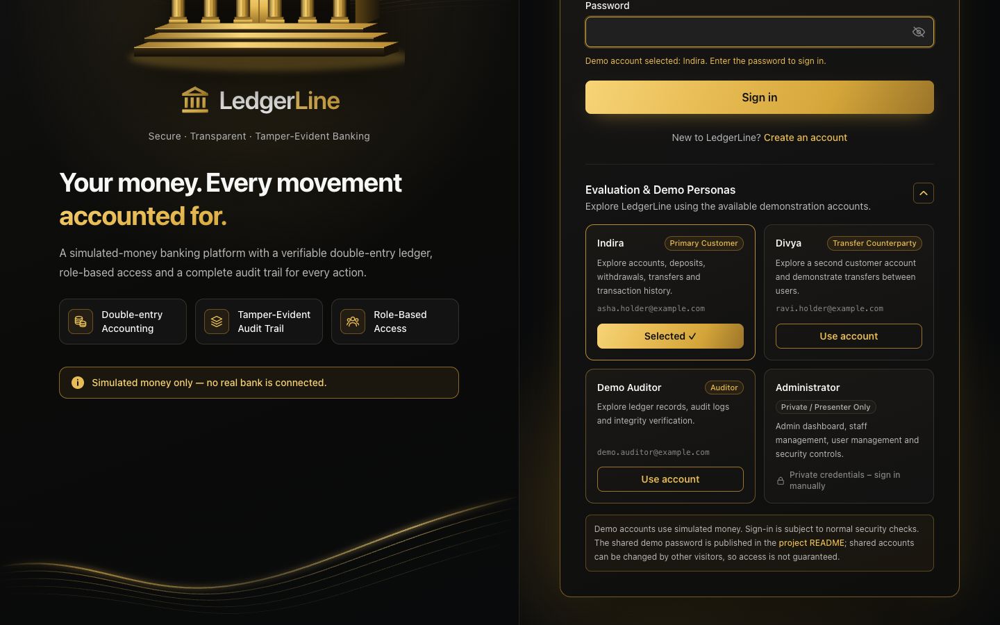 **Sign in** – branding panel and demo personas | 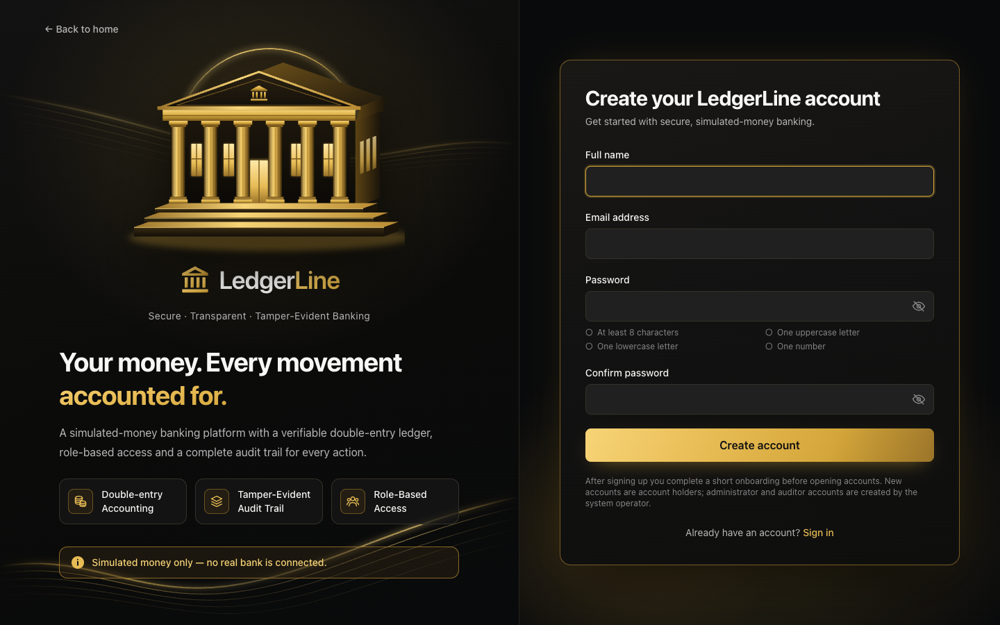 **Create account** – live password checklist |
| 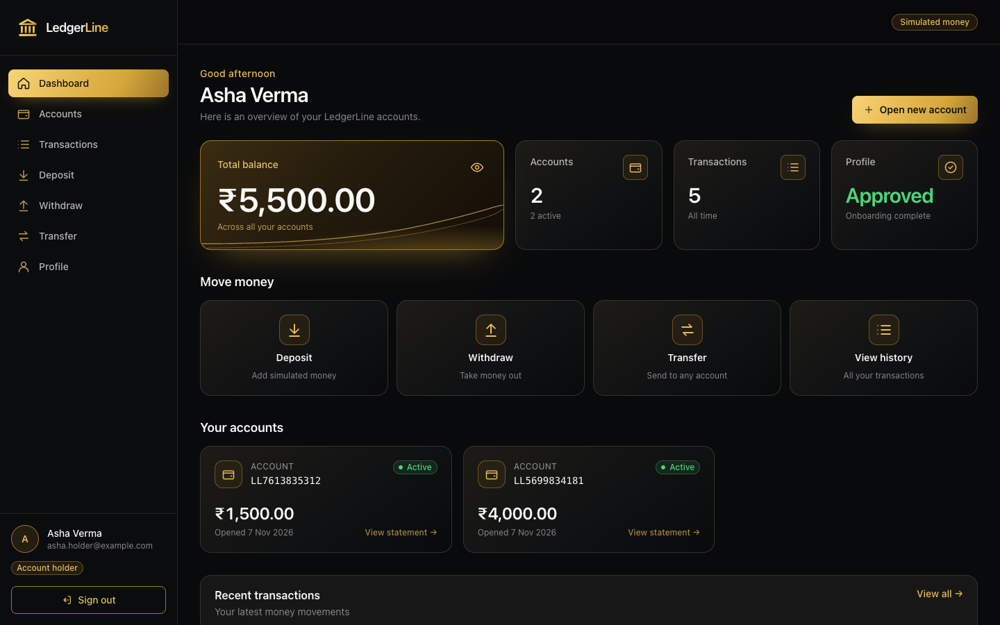 **Customer dashboard** – balance from the database, quick actions | 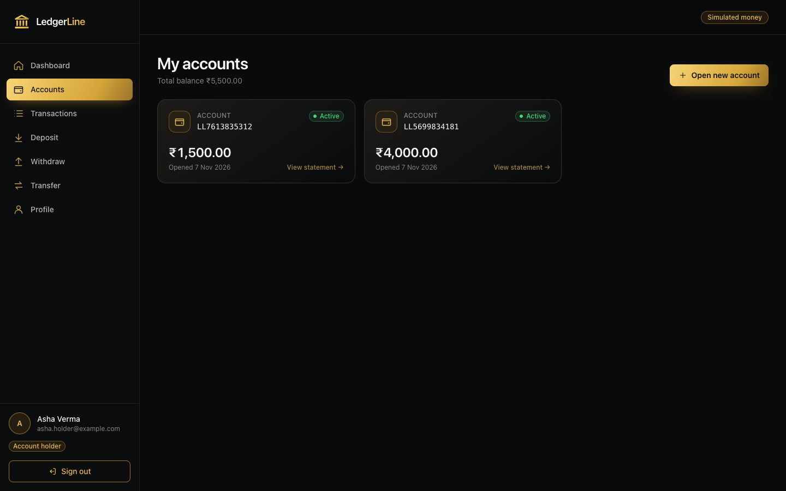 **Accounts** – status and balances |
| 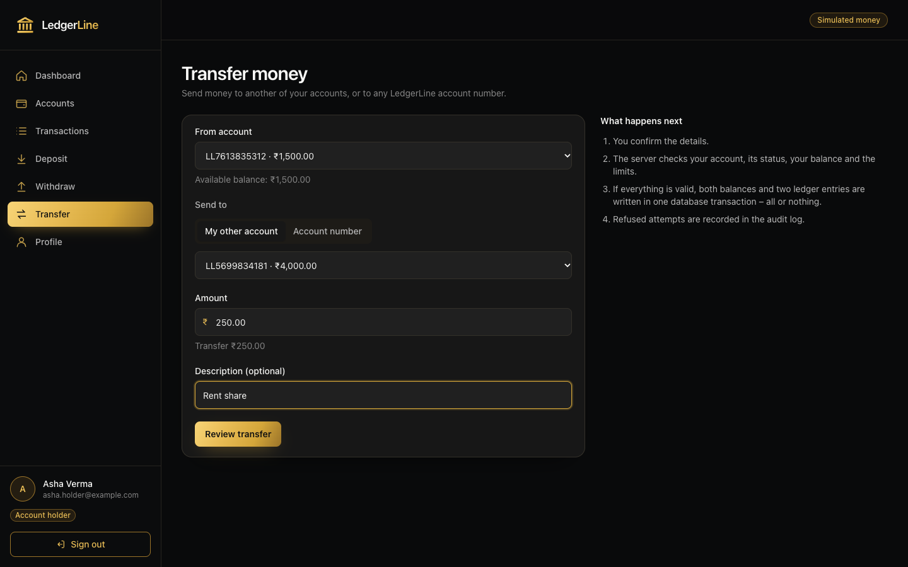 **Transfer** – own account or any account number | 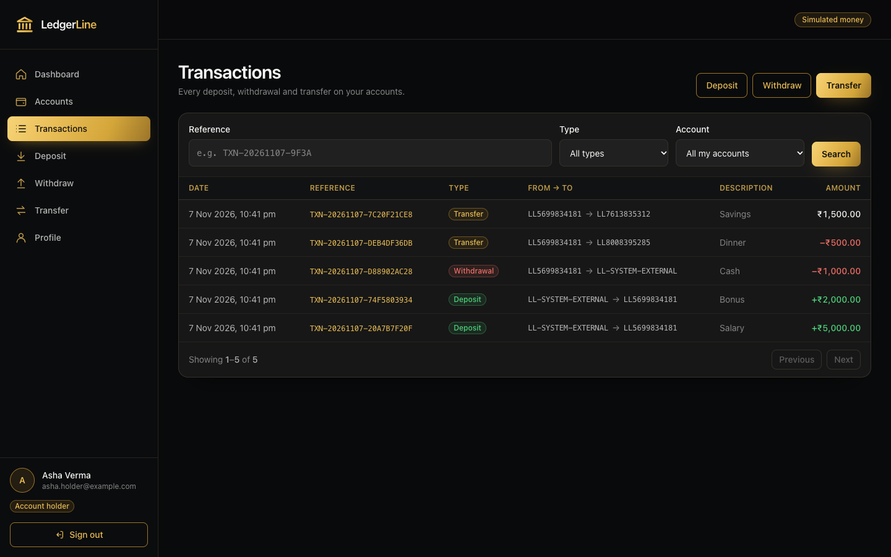 **Transaction history** – filters and direction |
| 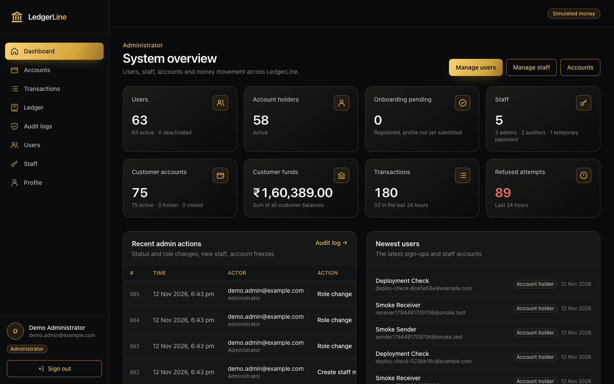 **Administrator overview** – computed by the database | 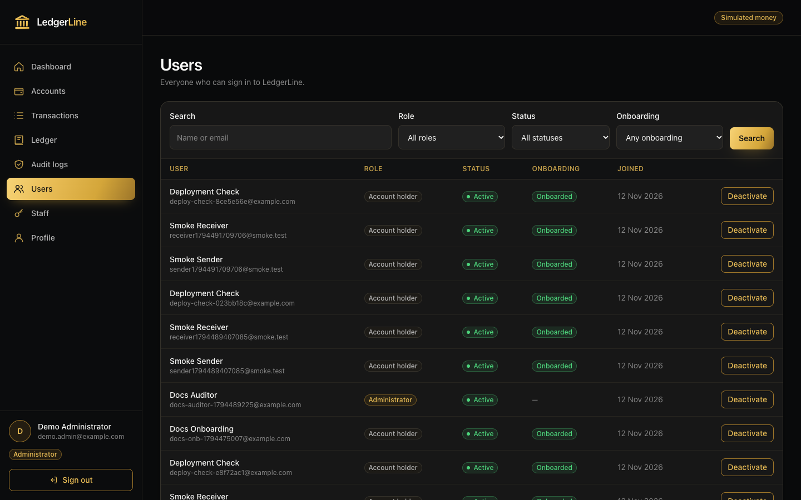 **User management** – search, filter, activate / deactivate |
| 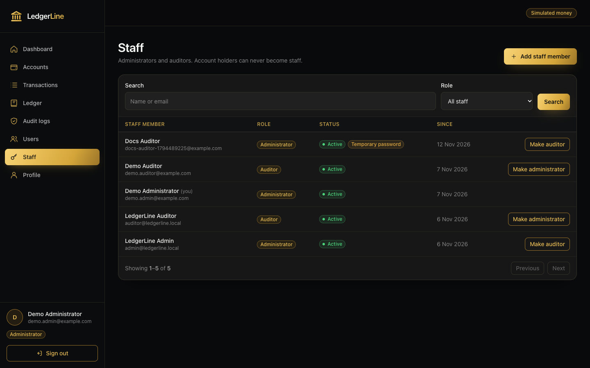 **Staff management** – admins and auditors | 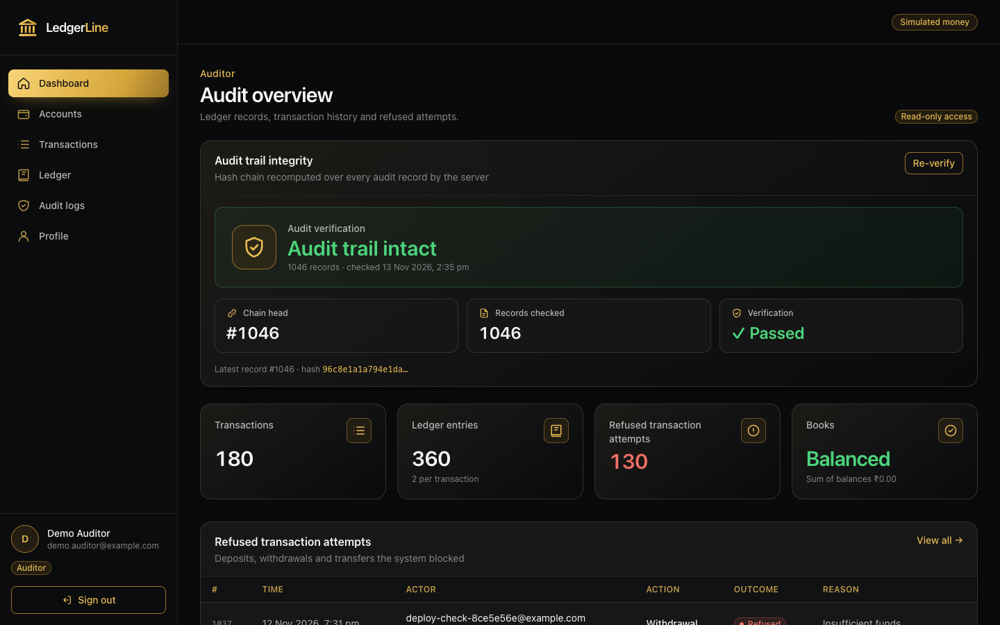 **Auditor dashboard** – audit-chain verification |
| 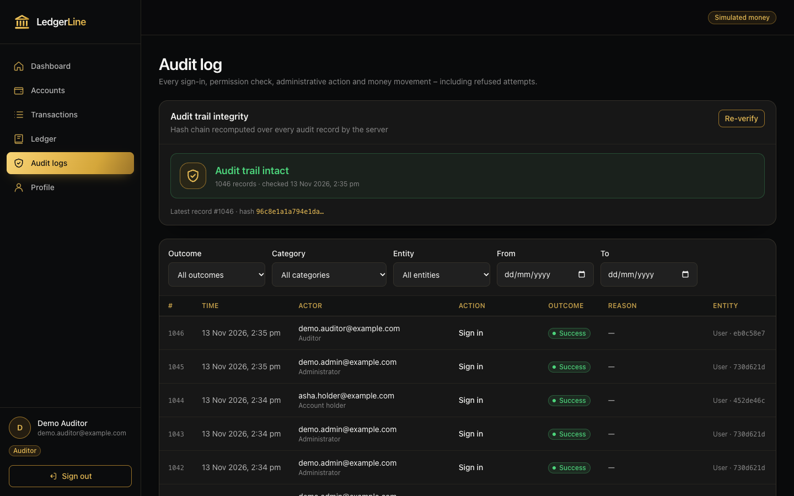 **Audit log** – hash-chain check and filters |  **Mobile** – responsive layout |

<sub>Screenshots of the actual application, captured locally from the development database with the seeded dummy demo data
(`example.com` addresses, simulated money).</sub>

## 4. Key features

**Customers (account holders)**
- **Registration and sign-in** with an HttpOnly session cookie. Password rules: 8+ characters with upper- and lowercase letters and a
  number; very common passwords and passwords containing the email name are refused.
- **Onboarding** before any money moves: a demo profile (age 18+, mobile number, city, state, PIN code, occupation) and acceptance of the
  current terms, approved automatically. The API *and* database triggers refuse accounts and money movement before approval.
- **Accounts:** open up to 5; balances, statements with a ledger proof (credits − debits = balance).
- **Deposits, withdrawals and transfers** (to own accounts or any account number) with a confirmation step and a receipt.
- **Transaction history** with search and filters; details never reveal the other party's balance.
- **"Retry safely"** after a network error — the same idempotency key is re-sent, so a payment is never made twice.

**Administrators**
- **Dashboard** computed by the database: users by role and status, pending onboardings, staff with temporary passwords, accounts by
  status, customer funds, transactions, refused attempts, recent admin actions, ledger and audit-trail integrity.
- **User management:** search and filter, user details with minimised personal data (age only, masked phone), activate / deactivate and
  "sign out everywhere" — each with an optional reason in the audit log.
- **Staff management:** create administrators and auditors (a temporary password shown once, which must be changed at first sign-in) and
  switch ADMIN ↔ AUDITOR — both confirmed with the admin's own password. Account holders can never become staff and the last active admin
  can never be removed (also enforced by database triggers).
- Freeze, unfreeze and close accounts. Administrators **cannot move money** (separation of duties).

**Auditors**
- Read-only access to all accounts, statements, transactions, the raw ledger and the audit log (filters by outcome, category, entity and date).
- Live **ledger verification** and **audit-trail hash-chain verification**, plus the list of refused transaction attempts.

**Platform**
- Double-entry ledger with database-enforced integrity · idempotent money movement · row-level locking with deadlock retry.
- Role-based access control checked on the server for every request; a complete audit trail **including refused attempts**.
- **Tamper-evident audit trail:** append-only and SHA-256 hash-chained by the database with a gapless sequence; a changed, removed or
  reordered record is detected and named. Secrets are redacted from audit metadata.
- **Redis rate limiting** per IP plus a **per-account login lockout**; sign-in fails closed (503) if Redis is unavailable.
- Liveness and readiness endpoints (`/api/health/live`, `/api/health/ready`: database, Redis, ledger protections, limited database role).

## 5. Technology stack

Versions are those in the repository's `package.json` / lock files.

| Area | Technology |
|---|---|
| **Frontend** | React 19.3, React Router 8.5, Vite 8.3, Tailwind CSS 4.3, Axios 1.21 |
| **Backend** | Node.js ≥ 20 (developed on 26), Express 5.3, Zod 4.6 (validation), jsonwebtoken 9 (JWT, HS256), bcrypt 6, Helmet 8, cors, cookie-parser |
| **Database** | PostgreSQL (17 locally, 18 on Neon), Prisma ORM 6.19 — hand-written SQL constraints and triggers in the migrations |
| **Cache and security** | Redis (node-redis 6.3) with express-rate-limit 8.7 + rate-limit-redis 6.0; Redis 7.4 locally (Docker), Render Key Value in production |
| **Testing** | Jest 30 + Supertest 7 (backend), Playwright 1.65 in Chrome (browser), Node test runner (frontend units), oxlint |
| **Deployment** | Vercel (frontend + `/api` rewrite), Render (backend, `render.yaml` Blueprint), Neon (managed PostgreSQL), Render Key Value (Redis) |

## 6. System architecture

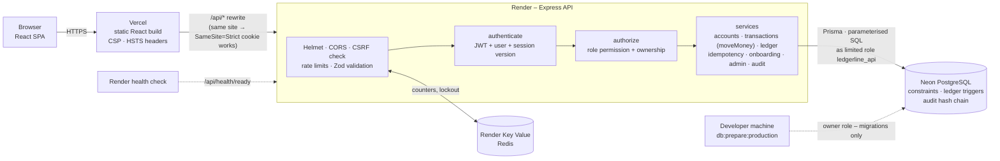

- **Frontend** (`frontend/`): pages call small API modules (`src/api/`) through one Axios client. Role checks in the UI only decide what
  to *show*; the server decides what is *allowed*.
- **Backend** (`backend/`): `routes → middleware → controllers → services`. All money movement goes through one function,
  `moveMoney()` in `src/services/transaction.service.js`.
- **Database:** the API connects as `ledgerline_api`, which can read and write rows but owns no tables and cannot change the schema or
  disable triggers. Migrations run separately with the owner role, from the developer's machine.
- **Redis** holds only rate-limit counters (no personal data); the key prefix separates environments.

## 7. Banking and ledger design

**Double-entry accounting.** Every transaction writes exactly two ledger entries of the same amount: a **DEBIT** on the account money
leaves and a **CREDIT** on the account it reaches. A special **SYSTEM account** (`LL-SYSTEM-EXTERNAL`) represents money outside
LedgerLine, so deposits and withdrawals are double-entry too:

| Operation (₹1,000) | DEBIT | CREDIT |
|---|---|---|
| Deposit | SYSTEM account | customer account |
| Withdrawal | customer account | SYSTEM account |
| Transfer A → B | account A | account B |

Because every debit has a matching credit, **all balances sum to ₹0** at all times (the SYSTEM account goes negative as customers deposit).
Money is stored as `BIGINT` **paise** (₹5,000.00 = `500000`) — never floating point.

**Rules enforced by PostgreSQL** — even if application code were wrong:

| Rule | Enforced by |
|---|---|
| Customer balances never go below ₹0 | `CHECK` constraint |
| Ledger entries, transactions and audit logs cannot be updated, deleted or truncated | append-only triggers |
| Every new entry continues its account's running balance | `ledger_entries_check_chain` trigger |
| At commit, every transaction has exactly one matching DEBIT and CREDIT | deferred `transactions_must_balance` trigger |
| At commit, every changed balance equals its latest ledger balance | deferred `accounts_balance_matches_ledger` trigger |
| Accounts and money movement only for onboarded customers; staff own no customer accounts | triggers |
| At least one active administrator always remains | deferred `users_keep_one_active_admin` trigger |

**One transfer, step by step**

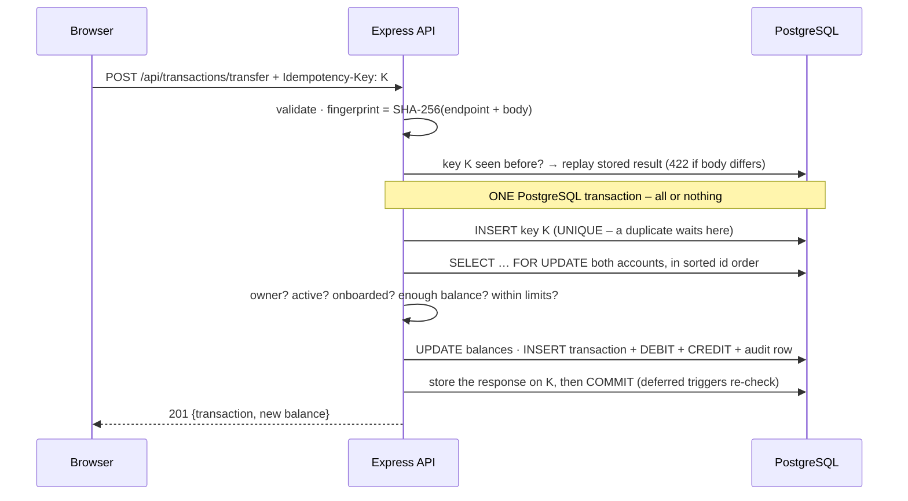

**Idempotency.** The browser creates one random key per operation and sends it as `Idempotency-Key` (required). The key row is inserted
**inside the same transaction** as the money movement under `UNIQUE(userId, key)`, so a committed movement always has exactly one key.

| Retry | Result |
|---|---|
| Same key, same request | the **original** response with `Idempotent-Replayed: true` — nothing moves again |
| Same key, different request | `422 IDEMPOTENCY_KEY_REUSED` |
| Same key sent many times at once | duplicates wait on the unique index; exactly **one** transaction |

**Concurrency.** Balances are checked on rows locked with `SELECT … FOR UPDATE`; accounts are locked in sorted id order to avoid
deadlocks, and a reported deadlock is retried up to 3 times. The classic test — ₹800 and ₹700 withdrawn from ₹1,000 at the same moment —
runs 20 times: always one success and one `INSUFFICIENT_FUNDS`, never a negative balance.

**Verify at any time:** `GET /api/ledger/verify` (admin/auditor) recomputes every balance from the ledger; `npm run verify:db` runs
17 read-only database checks.

## 8. Database schema

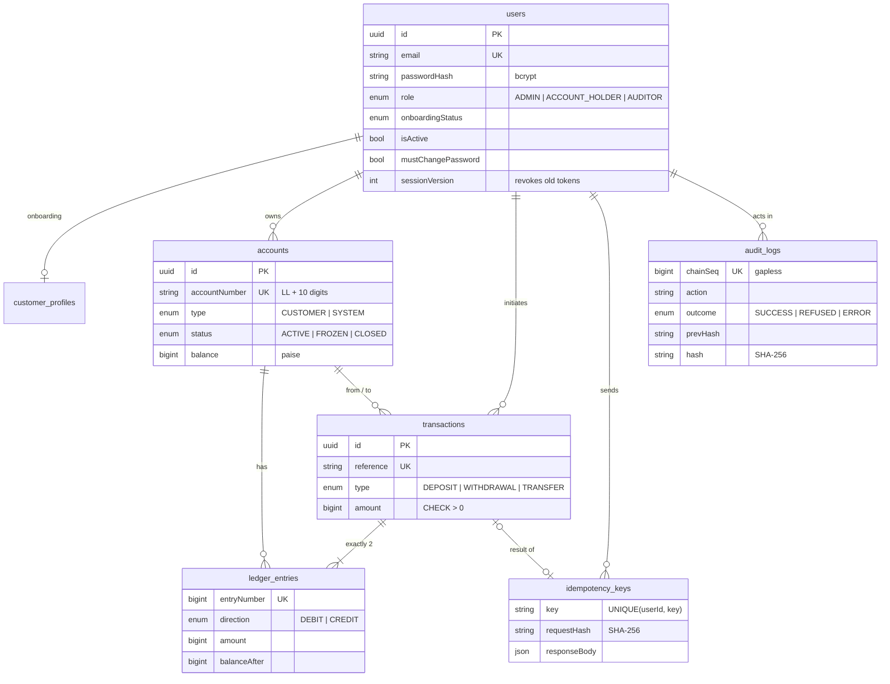

Schema: [`backend/prisma/schema.prisma`](backend/prisma/schema.prisma) · migrations, including the hand-written constraints and triggers:
[`backend/prisma/migrations/`](backend/prisma/migrations/) · rollback scripts: [`backend/prisma/rollbacks/`](backend/prisma/rollbacks/).

## 9. Security architecture

| Control | Implementation |
|---|---|
| **Password hashing** | bcrypt, cost 12; a dummy hash for unknown emails keeps login timing equal |
| **Password policy** | character rules, a common-password blocklist, no email name inside the password |
| **Sessions** | JWT (HS256, issuer, audience, 1 h expiry) only in an `HttpOnly`, `Secure`, `SameSite=Strict` cookie; logout and admin actions revoke every older token (session version) |
| **CSRF** | cookie-authenticated writes must send `X-Requested-With`, which other sites cannot add |
| **Role-based permissions** | role read from the database on every request; ownership checks on every account and transaction |
| **Rate limiting** | Redis-backed, shared by all instances: general per-IP limit, login and registration limits, change-password limit |
| **Account lockout** | 10 failed logins per account within 15 minutes, from any IP (keyed by a SHA-256 of the email) |
| **Fail closed** | if Redis is down, sign-in, registration and staff confirmations answer 503 instead of running unprotected |
| **Restricted database role** | the API runs as `ledgerline_api` (rows only – no schema changes, cannot disable triggers) |
| **Database-enforced integrity** | constraints and triggers listed in [section 7](#7-banking-and-ledger-design) |
| **Audit logging** | successes **and refusals**, rejected sessions, rate-limit blocks and admins viewing personal data; secrets redacted |
| **Tamper-evident hash chain** | each audit record stores the SHA-256 of its content and the previous record's hash; `GET /api/audit-logs/verify` names any broken link |
| **HTTP hardening** | Helmet, strict CORS (exact origins), CSP and HSTS on Vercel, Zod validation, uniform error responses |

All of this is tested, but LedgerLine has **not** been independently penetration-tested or security-certified — see
[THREATS.md](THREATS.md) (16 threats with protections, proving tests and accepted risks) and [docs/SECURITY_AUDIT.md](docs/SECURITY_AUDIT.md).

## 10. Roles and demo experience

| Role | Can | Cannot |
|---|---|---|
| **Customer** (account holder) | onboard, open accounts, deposit, withdraw, transfer, see own history and statements | see other customers' data, move money from accounts they don't own |
| **Administrator** | dashboard, user and staff management, freeze / unfreeze / close accounts, read the ledger and audit log | move money; remove the last active admin; turn a customer into staff |
| **Auditor** | read every account, transaction, ledger entry and audit record; verify the ledger and the audit chain | change anything |

**Evaluation & Demo Personas** (sign-in page). A collapsible panel lists the public demo accounts. **Use account** only fills in the email,
clears the password field and moves the cursor there — it never signs in and the app never contains a password; normal rate limits and
lockout apply.

| Card label | Signs in as (existing public demo account) | Role |
|---|---|---|
| Indira — Primary Customer | `asha.holder@example.com` | Account holder |
| Divya — Transfer Counterparty | `ravi.holder@example.com` | Account holder |
| Demo Auditor | `demo.auditor@example.com` | Auditor |
| Administrator — Private / Presenter Only | no public login | Administrator |

"Indira" and "Divya" are **display labels on the cards only**; after signing in the app shows the accounts' real demo names
(Asha Verma, Ravi Kumar). The administrator has no public demo login on the deployed site. Shared demo accounts can be changed by any
visitor, so their availability is not guaranteed.

## 11. Testing and verification

**Automated test suites** (run locally; the Black & Gold frontend was re-verified locally on 2026-11-13: browser 35/35, frontend units 16/16, build and lint clean):

| Command (folder) | Covers | Result |
|---|---|---|
| `npm test` (backend) | Jest + Supertest on a separate test database: auth, authorization, accounts, transactions, **financial integrity**, **idempotency**, **concurrency**, ledger tampering, rate limits in Redis (incl. Redis down), readiness, bootstrap, database roles, onboarding, admin / user / staff management, audit hash chain and security events | **436 tests** |
| `npm run test:e2e` (frontend) | Playwright in Chrome: registration, login, roles, money forms, history, lost-response retry, onboarding, admin dashboard, staff lifecycle, audit verification, password rules, mobile layout | **35 tests** |
| `npm test` (frontend) | amount parsing (no floating point), validation, error messages, idempotency keys | **16 tests** |
| `npm run smoke` (backend) | end-to-end API check against a running dev server | **61 checks** |
| `npm run verify:db` (backend) | read-only checks of a real database (money conserved, ledger consistent, triggers installed, limited role, audit chain intact) | **17 checks** |

The backend figures are from the last full backend run recorded in the project documentation (Step 6, before deployment); the backend
was not changed afterwards. Several safeguards were also **mutation-tested** — removed on purpose to confirm the tests fail.

**Production verification (historical, 2026-11-13, before the Black & Gold redesign)** — recorded in [docs/DEPLOYMENT.md](docs/DEPLOYMENT.md):
- `verify-db` against production as the limited role: **17/17**; readiness: database, Redis, schema and role all `ok`.
- `verify-deployment` through the live site: **29/29** (security headers, roles, secure cookie, onboarding, money movement, idempotency,
  the ₹800 + ₹700 race, ledger and audit-chain verification).
- Audit hash chain intact through record #170; existing customer balances unchanged by the migrations.

The redesigned frontend has been tested locally only; the production checks above have not been repeated since the redesign.

## 12. Local setup

**Prerequisites:** Node.js ≥ 20, PostgreSQL 17, Docker (for a local Redis), Google Chrome (browser tests).

```bash
# 1. Database (macOS / Homebrew) – the table OWNER, used for migrations only
brew services start postgresql@17
psql -d postgres -c "CREATE ROLE ledgerline_app WITH LOGIN PASSWORD 'choose-a-password' CREATEDB CREATEROLE;"
createdb -O ledgerline_app ledgerline

# Redis for rate-limit counters – local only, nothing kept on disk
docker run -d --name ledgerline-redis --restart unless-stopped -p 127.0.0.1:6379:6379 redis:7.4.2-alpine redis-server --save "" --appendonly no

# 2. Backend
cd backend
cp .env.example .env            # fill in the variables listed in section 13 (never commit .env)
npm install                     # also runs `prisma generate`
npm run db:deploy               # apply migrations to your LOCAL database (owner connection)
npm run db:roles                # create the limited ledgerline_api role
npm run db:seed                 # SYSTEM account
npm run db:seed:demo            # optional: demo users and transactions
npm run dev                     # http://localhost:4000

# 3. Frontend (second terminal)
cd frontend
cp .env.example .env            # VITE_API_BASE_URL=http://localhost:4000/api
npm install
npm run dev                     # http://localhost:5173
```

Open **http://localhost:5173** (use `localhost` – CORS allows the exact origin only). Production builds: `cd frontend && npm run build`.

**Tests** need a separate database named `ledgerline_test` and `backend/.env.test` (copy `backend/.env.test.example`):

```bash
createdb -O ledgerline_app ledgerline_test
cd backend && npm test          # prepares ledgerline_test automatically
cd ../frontend && npm test && npm run test:e2e
```

The test tools refuse any database not named `ledgerline_test` and any Redis that is not local. The production database is never
touched by local setup — production migrations follow [docs/DEPLOYMENT.md](docs/DEPLOYMENT.md).

## 13. Environment variables

Real values live in `backend/.env` and `frontend/.env`, which Git ignores; templates are `backend/.env.example`,
`backend/.env.test.example` and `frontend/.env.example`. The server validates every variable at startup.

| Variable | Required | Purpose |
|---|---|---|
| `DATABASE_URL` | ✅ | connection as the limited API role `ledgerline_api` |
| `DIRECT_DATABASE_URL` | migrations | connection as the table owner – migrations and `db:roles` only, never used by the server |
| `JWT_SECRET` | ✅ | ≥ 32 random characters |
| `REDIS_URL` | ✅ in production | rate-limit counters (development falls back to memory) |
| `CORS_ORIGIN` | | exact frontend origin(s), default `http://localhost:5173` |
| `NODE_ENV`, `PORT`, `JWT_EXPIRES_IN`, `BCRYPT_SALT_ROUNDS` | | runtime settings (defaults `production`, `4000`, `1h`, `12`) |
| `RATE_LIMIT_MAX`, `AUTH_LOGIN_FAILURE_LIMIT`, `AUTH_REGISTER_LIMIT`, `AUTH_ACCOUNT_FAILURE_LIMIT` | | rate-limit settings (defaults 600 / 10 / 10 / 10) |
| `REDIS_KEY_PREFIX`, `TRUST_PROXY` | | Redis key namespace; number of proxies in front of the API |
| `SEED_ADMIN_*`, `SEED_AUDITOR_*` | seeding | optional development staff created by `npm run db:seed` |
| `VITE_API_BASE_URL` (frontend) | ✅ | API base URL – public, bundled into the JavaScript |

## 14. Deployment

| Part | Platform | Notes |
|---|---|---|
| Frontend | **Vercel** | `frontend/vercel.json`: `/api/*` rewrite to Render (one site for the browser, so the `SameSite=Strict` cookie works), SPA fallback, CSP / HSTS headers |
| Backend | **Render** | `render.yaml` Blueprint; health check `/api/health/ready` – a new version goes live only when database, Redis, schema protections and the limited role are all `ok` |
| Database | **Neon** PostgreSQL 18 | API connects as `ledgerline_api`; migrations run from the developer machine with `npm run db:prepare:production` |
| Rate limits | **Render Key Value** (Redis) | production refuses to start without `REDIS_URL` |

The step 4 and step 5–6 migrations were rehearsed on a copy of the development database, preceded by Neon backup branches
(`pre-step4`, `pre-step56`), and followed by `verify-db` and the live checks. Full procedure, verification records and rollback strategy: **[docs/DEPLOYMENT.md](docs/DEPLOYMENT.md)**.

## 15. API endpoints

Full reference with request bodies, responses and error codes: **[docs/API.md](docs/API.md)**.

| Method | Endpoint | Role |
|---|---|---|
| GET | `/api/health` · `/api/health/live` · `/api/health/ready` | public |
| POST | `/api/auth/register` · `/api/auth/login` · `/api/auth/logout` · `/api/auth/change-password` | public / signed in |
| GET | `/api/auth/me` | signed in |
| GET · POST | `/api/onboarding` | account holder |
| GET · POST | `/api/accounts` | signed in (holders see their own) · account holder, onboarded |
| GET | `/api/accounts/:id` · `/:id/balance` · `/:id/statement` | owner, admin, auditor |
| PATCH | `/api/accounts/:id/status` | admin |
| POST | `/api/transactions/deposit` · `/withdraw` · `/transfer` (+ `Idempotency-Key`) | account holder, onboarded |
| GET | `/api/transactions` · `/api/transactions/:id` | signed in (holders see their own) |
| GET | `/api/ledger/entries` · `/api/ledger/verify` | admin, auditor |
| GET | `/api/audit-logs` · `/api/audit-logs/verify` | admin, auditor |
| GET · PATCH · POST | `/api/admin/overview` · `/api/admin/users` · `/:id` · `/:id/status` · `/:id/revoke-sessions` | admin |
| GET · POST · PATCH | `/api/admin/staff` · `/api/admin/staff/:id/role` (own password for changes) | admin |

## 16. Known limitations

- **Simulated money only**; INR only; per-transaction limits but no daily limits.
- **No real identity verification (KYC):** any valid, made-up onboarding profile is approved automatically.
- **No MFA** and no two-person approval for administrators; temporary staff passwords are handed over outside the system.
- **Public demo accounts are shared:** anyone can use them, change their password or trigger their lockout.
- The per-account lockout can be triggered by anyone who knows an email address; no CAPTCHA. If Redis is down, nobody can sign in (fail closed).
- A stolen session token works for up to 1 hour unless the user logs out.
- Whoever holds the database **owner** password can still disable the triggers (the API itself cannot).
- The audit chain has no external anchor: a consistent rewrite of the newest records is detectable only against a chain head noted elsewhere.
- Idempotency keys expire after 24 hours and are not cleaned up by a scheduled job.
- Deposits and withdrawals serialize on the single SYSTEM account row (throughput, not safety).
- **No independent penetration test**; free hosting sleeps when idle (slow first request).

Details and the full list of accepted risks: [THREATS.md](THREATS.md).

## 17. Demo credentials

Safe **dummy** accounts created by `npm run db:seed:demo` (reserved `example.com` addresses, simulated money). The password is a
deliberately public demo value, also visible in [`backend/prisma/seed-demo.js`](backend/prisma/seed-demo.js); the sign-in page links here
instead of embedding it.

| Role | Email | Password |
|---|---|---|
| Account holder (card "Indira") | `asha.holder@example.com` | `DemoPass123` |
| Account holder (card "Divya") | `ravi.holder@example.com` | `DemoPass123` |
| Auditor | `demo.auditor@example.com` | `DemoPass123` |
| Administrator | `demo.admin@example.com` – **local development only** | `DemoPass123` |

The public demo admin is never created on the deployed site (`db:prepare:production` sets `SEED_DEMO_ADMIN=false`); the real first
administrator is created once with `npm run admin:bootstrap` (password typed at a hidden prompt, never printed or stored). Further admins
and auditors are created in the app under **Staff → Add staff member**. **Never use the demo accounts for real data.**

## 18. Project highlights

- **Financial integrity enforced by the database** — balances, double entries, running balances and append-only history are checked by
  PostgreSQL constraints and triggers, not only by application code.
- **Idempotent, concurrency-safe money movement** — one transaction per movement, keys claimed inside it, row locks in a fixed order.
- **Least-privilege production database access** — the API runs as a role that cannot change the schema or disable protections.
- **Tamper-evident audit history** — SHA-256 hash chain with a gapless sequence, verifiable from the auditor dashboard.
- **Three role-specific interfaces** — customer, administrator and read-only auditor, with server-side authorization everywhere.
- **Verified, not assumed** — 436 backend, 35 browser and 16 frontend unit tests, mutation tests of key safeguards, migration rehearsals,
  and recorded production checks (17/17 database, 29/29 live).

## 19. Project documentation

| Document | Contents |
|---|---|
| [docs/PROJECT_SUMMARY.md](docs/PROJECT_SUMMARY.md) | Short project write-up: problem, what was built, AI use and mistakes, what is not finished |
| [docs/DEPLOYMENT.md](docs/DEPLOYMENT.md) | Deployment to Vercel, Render and Neon; production verification records; rollback strategy |
| [docs/API.md](docs/API.md) | API reference: every endpoint, request, response and error code |
| [THREATS.md](THREATS.md) | Threat model: 16 threats, protections, proving tests, accepted risks |
| [docs/SECURITY_AUDIT.md](docs/SECURITY_AUDIT.md) | Day 3 security audit with the result of each attack |
| [PROMPTS.md](PROMPTS.md) | AI usage log: prompts, what AI generated, what was wrong and how it was fixed |
| [docs/RESUME_PROJECT.md](docs/RESUME_PROJECT.md) | Resume and portfolio descriptions of the project |
| [frontend/README.md](frontend/README.md) | Frontend structure and scripts |
