# LedgerLine X – Money Movement with a Ledger You Can Prove

A full-stack banking simulation where every rupee is traceable: deposits, withdrawals and transfers are written to a
**double-entry ledger** that PostgreSQL itself keeps balanced, duplicates are impossible thanks to **idempotency keys**,
and simultaneous requests can never overdraw an account.

> ⚠️ **Simulated money only.** LedgerLine is a learning project. It is not connected to any bank or payment gateway.

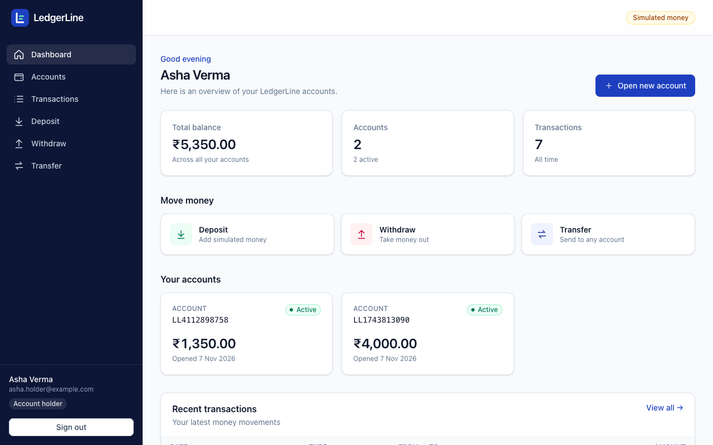

## Contents

1. [Overview](#1-overview) · 2. [Problem statement](#2-problem-statement) · 3. [Features](#3-features) · 4. [Technology stack](#4-technology-stack) ·
5. [Architecture](#5-architecture) · 6. [Database schema](#6-database-schema) · 7. [Authentication workflow](#7-authentication-workflow) ·
8. [Transaction workflow](#8-transaction-workflow) · 9. [Idempotency](#9-idempotency) · 10. [Concurrency protection](#10-concurrency-protection) ·
11. [Ledger integrity](#11-ledger-integrity) · 12. [API endpoints](#12-api-endpoints) · 13. [Installation](#13-installation) ·
14. [Environment variables](#14-environment-variables) · 15. [Testing](#15-testing) · 16. [Deployment](#16-deployment) ·
17. [Demo credentials](#17-demo-credentials) · 18. [Screenshots](#18-screenshots) · 19. [Limitations and future enhancements](#19-limitations-and-future-enhancements) ·
20. [Project documents](#20-project-documents)

---

## 1. Overview

LedgerLine lets **account holders** open accounts, deposit simulated money, withdraw it and transfer it to anyone;
**administrators** manage accounts and users; **auditors** inspect the ledger, every transaction and every refused attempt –
read-only. The backend is the single source of truth: the React app never decides whether money may move.

## 2. Problem statement

Moving money looks simple – subtract here, add there – but real systems fail in subtle ways:

| Failure | Example |
|---|---|
| **Duplicates** | The network drops after a transfer succeeds; the user retries and pays twice. |
| **Races** | ₹800 and ₹700 are withdrawn from a ₹1,000 account at the same moment and both succeed. |
| **Partial writes** | The server crashes after debiting one account but before crediting the other. |
| **Silent tampering** | A balance is changed directly in the database and nobody can tell. |

LedgerLine is built so that each of these is **prevented by design and proven by automated tests** – and so that any balance
can be re-derived from the ledger at any time ("a ledger you can prove").

## 3. Features

**Account holders**
- Register and sign in (HttpOnly cookie session); open up to 5 accounts.
- Deposit (simulated), withdraw, and transfer to own accounts or any account number – with a confirmation step and a receipt.
- Transaction history with search and filters; details that never reveal the other party's balance.
- Statements with a **ledger proof** (credits − debits = balance).
- "Retry safely" after a network error – never pays twice.

**Administrators**
- System overview (users, accounts, customer funds, transactions, refused attempts, ledger integrity).
- Freeze, unfreeze and close accounts; activate and deactivate users (revokes their sessions immediately).
- Cannot move money (separation of duties).

**Auditors**
- Read-only access to all accounts, statements, transactions, the raw ledger and the audit log.
- Live ledger verification and a list of refused transaction attempts.

**Platform**
- Double-entry ledger with database-enforced integrity; idempotent money movement; row-level locking.
- Role-based access control checked on the server for every request; full audit trail including refusals.
- Helmet, strict CORS, CSRF protection, rate limiting, input validation, safe error responses.
- 261 backend tests, 23 browser tests, 12 frontend unit tests.

## 4. Technology stack

| Layer | Technology |
|---|---|
| Frontend | React 19, Vite 8, Tailwind CSS 4, React Router 8, Axios |
| Backend | Node.js (≥ 20), Express 5, Zod (validation), jsonwebtoken (JWT), bcrypt, Helmet, express-rate-limit, cookie-parser |
| Database | PostgreSQL 17, Prisma ORM 6 |
| Testing | Jest + Supertest (backend), Playwright (browser), Node test runner (frontend units) |
| Deployment | Vercel (frontend), Render (backend), managed PostgreSQL – see [Deployment](#16-deployment) |

## 5. Architecture

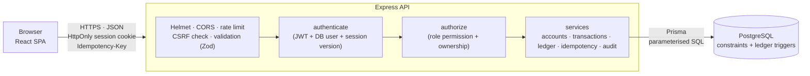

- **Frontend** (`frontend/`): pages call small API services (`src/api/`), all through one Axios client that adds credentials and turns
  every failure into a uniform error. Role checks in the UI only decide what to *show*.
- **Backend** (`backend/`): `routes → middleware → controllers → services`. Money logic lives in one function, `moveMoney()`
  (`src/services/transaction.service.js`).
- **Database**: constraints and triggers enforce the most important rules even if application code is wrong.

## 6. Database schema

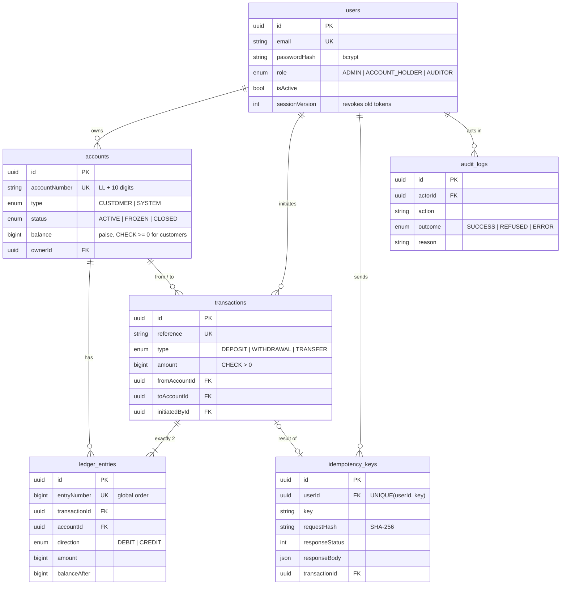

- **Money is stored as `BIGINT` paise** (₹5,000.00 = `500000`) – never floating point.
- A special **SYSTEM account** (`LL-SYSTEM-EXTERNAL`) represents money outside LedgerLine: deposits come from it and withdrawals go
  to it, so **every** movement has a debit and a credit and **all balances always sum to ₹0**.
- Schema: [`backend/prisma/schema.prisma`](backend/prisma/schema.prisma) · migrations (including hand-written constraints and
  triggers): [`backend/prisma/migrations/`](backend/prisma/migrations/).

## 7. Authentication workflow

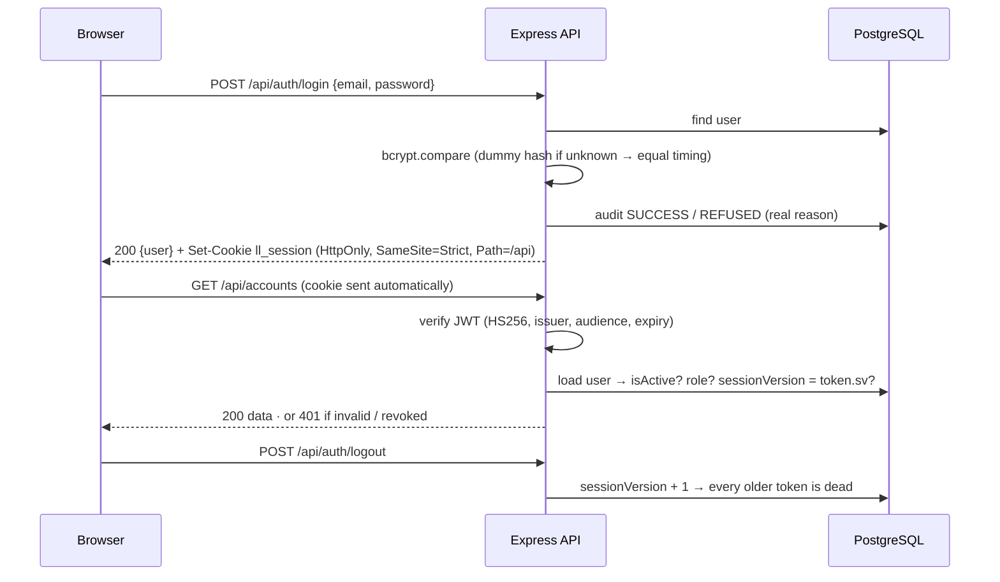

- The JWT lives only in an **HttpOnly cookie** – JavaScript (and therefore an XSS script) cannot read it.
- **CSRF:** cookie-authenticated `POST`/`PATCH` requests must send `X-Requested-With`, which other sites cannot add.
- The **role is read from the database** on every request; a role inside a token is ignored.
- **Logout and admin status changes revoke all existing tokens** of that user (session version).
- API tools can use `Authorization: Bearer <token>` (send `X-Auth-Mode: bearer` on login to receive it).

## 8. Transaction workflow

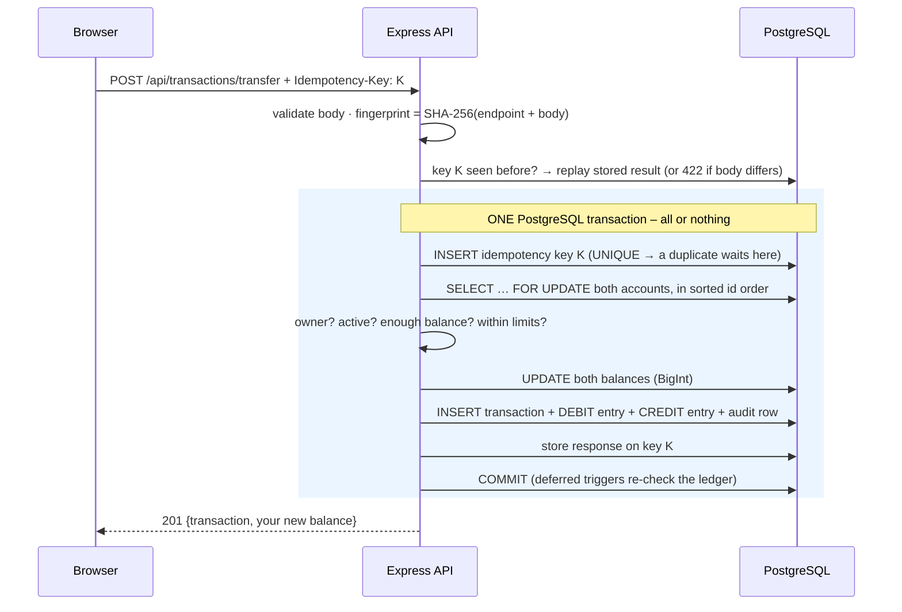

If any step fails, PostgreSQL rolls back **everything**, and the refusal is audited outside the rolled-back transaction.

## 9. Idempotency

**The problem:** a request can succeed on the server while the response is lost. A retry must not move the money again.

**The solution:**
1. The browser creates **one random key per operation** (UUID) and sends it as `Idempotency-Key`. The backend **requires** it.
2. The key row is inserted **inside the same database transaction** as the money movement, under `UNIQUE(userId, key)`.
   A committed movement therefore always has a committed key row – and only one can exist.
3. A **SHA-256 fingerprint** of the endpoint and the request body is stored with the key.
4. The final response is stored on the key before commit.

| Retry | Result |
|---|---|
| Same key, same request | the **original** response, `Idempotent-Replayed: true` – nothing moves again |
| Same key, different request | `422 IDEMPOTENCY_KEY_REUSED` |
| Same key, sent 25 times at once | PostgreSQL makes the duplicates wait; exactly **one** transaction |
| After a lost response | **Retry safely** in the UI re-sends the same body and key → "Already processed" |

Proven by 29 tests in `backend/tests/integration/idempotency.test.js`, including mutation tests (removing the key claim makes
duplicates appear and the tests fail).

## 10. Concurrency protection

- **Row-level locks:** `SELECT … FOR UPDATE` on the accounts inside the money transaction; balances are checked **on the locked row**,
  so a second request waits and then sees the real balance.
- **No deadlocks:** accounts are always locked in **sorted id order**; if PostgreSQL still reports a deadlock, the (rolled-back)
  transaction is retried up to 3 times with a short random wait.
- **Defence in depth:** a database trigger rejects any ledger entry that does not continue the account's running balance, so a lost
  update is refused even if the application lock were missing (shown in a mutation test).

**The classic test** – balance ₹1,000; ₹800 and ₹700 withdrawn at the same moment – is run 20 times: always exactly one success and
one `INSUFFICIENT_FUNDS`, never a negative balance. A separate test asks PostgreSQL how many requests are waiting for the lock at once
(12 of 12) to prove the tests are genuinely concurrent.

## 11. Ledger integrity

The rules that matter most are enforced **by PostgreSQL**, not only by application code:

| Rule | Enforced by |
|---|---|
| Customer balances never go below ₹0 | `CHECK` constraint |
| Ledger entries, transactions and audit logs cannot be updated, deleted or truncated | triggers |
| Every new entry continues its account's running balance | `ledger_entries_check_chain` trigger |
| At commit, every transaction has exactly one matching DEBIT and CREDIT | deferred `transactions_must_balance` trigger |
| At commit, every changed balance equals its latest ledger balance | deferred `accounts_balance_matches_ledger` trigger |
| A request is processed at most once | `UNIQUE(userId, key)` in the same transaction |

**Verify any time:** `GET /api/ledger/verify` (admin/auditor) or `npm run verify:db` (13 read-only checks, e.g. all balances sum to ₹0,
every balance equals credits − debits). Tests use a separate, independent SQL checker (`backend/tests/invariants.js`).

## 12. API endpoints

Full reference with request bodies, real responses and error codes: **[docs/API.md](docs/API.md)**.

| Method | Endpoint | Auth | Role |
|---|---|---|---|
| GET | `/api/health` | – | – |
| POST | `/api/auth/register` · `/api/auth/login` | – | – |
| GET | `/api/auth/me` | ✅ | any |
| POST | `/api/auth/logout` | optional | any |
| POST | `/api/accounts` | ✅ | ACCOUNT_HOLDER |
| GET | `/api/accounts` | ✅ | any (holders see their own) |
| GET | `/api/accounts/:id` · `/:id/balance` · `/:id/statement` | ✅ | owner, ADMIN, AUDITOR |
| PATCH | `/api/accounts/:id/status` | ✅ | ADMIN |
| POST | `/api/transactions/deposit` · `/withdraw` · `/transfer` | ✅ + `Idempotency-Key` | ACCOUNT_HOLDER (own accounts) |
| GET | `/api/transactions` | ✅ | any (holders see their own) |
| GET | `/api/transactions/:id` | ✅ | involved holder, ADMIN, AUDITOR |
| GET | `/api/ledger/entries` · `/api/ledger/verify` | ✅ | ADMIN, AUDITOR |
| GET | `/api/audit-logs` | ✅ | ADMIN, AUDITOR |
| GET | `/api/admin/users` · PATCH `/api/admin/users/:id/status` | ✅ | ADMIN |

## 13. Installation

**Prerequisites:** Node.js ≥ 20 (developed on 26), PostgreSQL 17 (`brew install postgresql@17` on macOS), Google Chrome (for browser tests).

```bash
# 1. Database (macOS / Homebrew)
brew services start postgresql@17
psql -d postgres -c "CREATE ROLE ledgerline_app WITH LOGIN PASSWORD 'choose-a-password' CREATEDB;"
createdb -O ledgerline_app ledgerline

# 2. Backend
cd backend
cp .env.example .env            # set DATABASE_URL, JWT_SECRET, SEED_* (see below)
npm install                     # also runs `prisma generate`
npm run db:deploy               # apply all migrations
npm run db:seed                 # SYSTEM account + admin/auditor from .env
npm run db:seed:demo            # optional: demo users and transactions
npm run dev                     # http://localhost:4000

# 3. Frontend (second terminal)
cd frontend
cp .env.example .env            # VITE_API_BASE_URL=http://localhost:4000/api
npm install
npm run dev                     # http://localhost:5173
```

Open **http://localhost:5173** (use `localhost`, not `127.0.0.1` – CORS allows the exact origin only).
Check the database at any time: `cd backend && npm run verify:db`.

## 14. Environment variables

Real values live in `backend/.env` and `frontend/.env`, which are **ignored by Git**. Templates: `backend/.env.example`,
`backend/.env.test.example`, `frontend/.env.example`. The server validates every variable at startup and refuses to start with
invalid values.

**Backend**

| Variable | Required | Default | Description |
|---|---|---|---|
| `DATABASE_URL` | ✅ | – | PostgreSQL connection string (use a dedicated, non-superuser role) |
| `JWT_SECRET` | ✅ | – | ≥ 32 random characters: `node -e "console.log(require('crypto').randomBytes(48).toString('hex'))"` |
| `NODE_ENV` | | `production` | `development` shows debug details in 500 errors; production hides them and marks cookies `Secure` |
| `PORT` | | `4000` | API port |
| `CORS_ORIGIN` | | `http://localhost:5173` | Comma-separated exact frontend origins (`*` is refused) |
| `JWT_EXPIRES_IN` | | `1h` | Session/token lifetime |
| `BCRYPT_SALT_ROUNDS` | | `12` | bcrypt cost (10–15) |
| `RATE_LIMIT_MAX` | | `600` | Requests per IP per 15 minutes |
| `AUTH_LOGIN_FAILURE_LIMIT` | | `10` | Failed logins per IP per 15 minutes |
| `AUTH_REGISTER_LIMIT` | | `10` | Registrations per IP per hour |
| `TRUST_PROXY` | | `0` | Number of proxies in front of the API (Render = 1; Vercel rewrite + Render = 2) |
| `SEED_ADMIN_EMAIL` / `SEED_ADMIN_PASSWORD` | for seeding | – | Admin created by `npm run db:seed` |
| `SEED_AUDITOR_EMAIL` / `SEED_AUDITOR_PASSWORD` | for seeding | – | Auditor created by `npm run db:seed` |

**Frontend**

| Variable | Required | Description |
|---|---|---|
| `VITE_API_BASE_URL` | ✅ | API base URL, e.g. `http://localhost:4000/api`. Public – bundled into the JavaScript, never put secrets here. |

**Tests** use `backend/.env.test` (copy `backend/.env.test.example`), which must point to a separate database named `ledgerline_test`.

## 15. Testing

| Command (folder) | What it covers | Result |
|---|---|---|
| `npm test` (backend) | Jest + Supertest: auth, authorization, accounts, transactions, **financial integrity**, **idempotency**, **concurrency**, ledger tampering, security audit, rate limits | 261 tests |
| `npm test` (frontend) | amount parsing (no floating point), validation, error messages, idempotency keys | 12 tests |
| `npm run test:e2e` (frontend) | Playwright in Chrome: registration, login, protected routes, roles, money forms, history, error handling, lost-response retry | 23 tests |
| `npm run smoke` (backend) | end-to-end API check against your running dev server | 56 checks |
| `npm run verify:db` (backend) | read-only check of the real database | 13 checks |

One-time setup for the test database:

```bash
createdb -O ledgerline_app ledgerline_test
cd backend && cp .env.test.example .env.test   # fill in password + test-only secrets
npm test                                       # prepares ledgerline_test automatically
```

The test tools refuse to run against any database that is not named `ledgerline_test`. Browser tests start their own servers
(:4001 / :5174) and use your installed Chrome.

## 16. Deployment

**Vercel** (frontend) · **Render** (backend) · **Neon** (managed PostgreSQL). Step-by-step guide: **[docs/DEPLOYMENT.md](docs/DEPLOYMENT.md)**.

**Live demo:** _URL added after the deployment has been verified._

- `render.yaml` – Render Blueprint (build `npm ci --include=dev`, start `npm run db:deploy && npm start`, health check `/api/health`).
- `frontend/vercel.json` – rewrites `/api/*` to the backend so the browser only talks to one site and the `SameSite=Strict` session cookie
  keeps working (`*.vercel.app` and `*.onrender.com` are different sites), SPA fallback, and security headers (CSP, HSTS, …).
- `npm run db:prepare:production` – migrations, SYSTEM account, demo data and verification on the production database
  (reads only `backend/.env.production`; never copies your private admin).
- `npm run verify:deployment -- <url>` – 24 end-to-end checks against the live site, including idempotency and the ₹800 + ₹700 race.

The whole setup was rehearsed locally first: production build with the same headers and `/api` forwarding, backend started exactly
like Render (clean install, `NODE_ENV=production`, no `.env`, empty database) – 24/24 deployment checks passed.

## 17. Demo credentials

Safe **dummy** accounts created by `npm run db:seed:demo` (reserved `example.com` addresses, simulated money):

| Role | Email | Password |
|---|---|---|
| Account holder | `asha.holder@example.com` | `DemoPass123` |
| Account holder | `ravi.holder@example.com` | `DemoPass123` |
| Administrator | `demo.admin@example.com` | `DemoPass123` |
| Auditor | `demo.auditor@example.com` | `DemoPass123` |

The demo seed creates 3 accounts and 6 transactions plus one refused withdrawal, all through the real transaction service, with
fixed idempotency keys – running it again replays instead of duplicating. **Never use these credentials for real data.** The
private admin/auditor created by `npm run db:seed` use the credentials from your own `.env`.

## 18. Screenshots

| | |
|---|---|
| 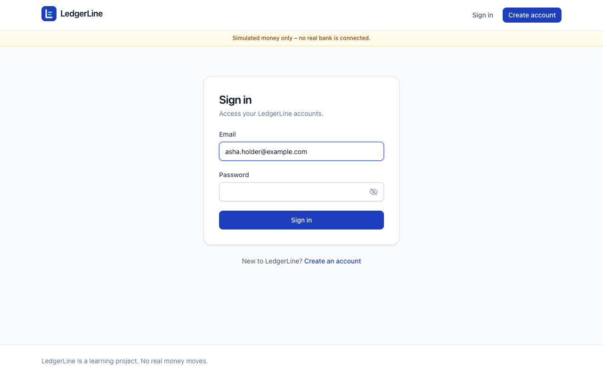 Sign in |  Account holder dashboard |
| 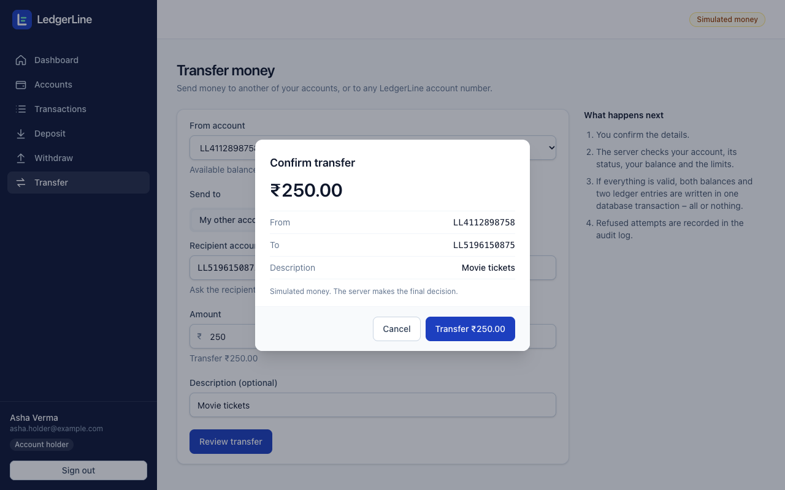 Transfer – confirmation step | 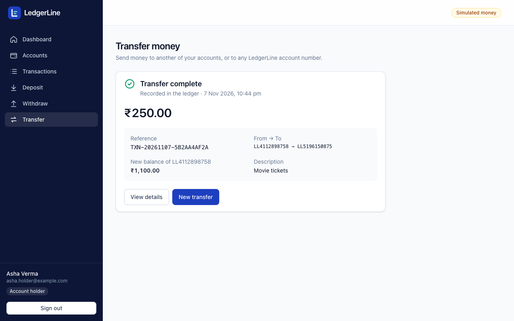 Receipt with new balance |
| 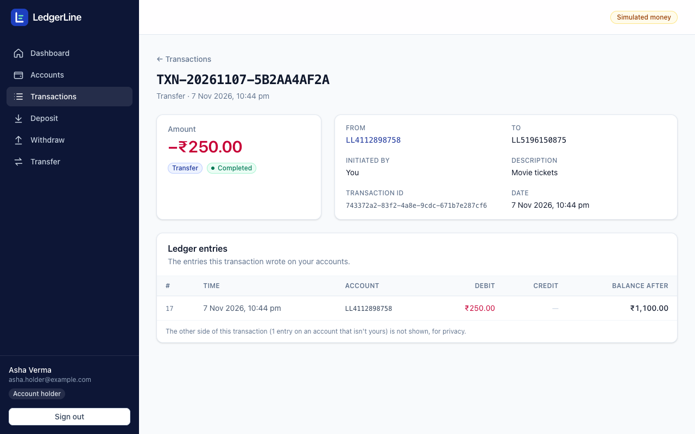 Details – the other side stays private | 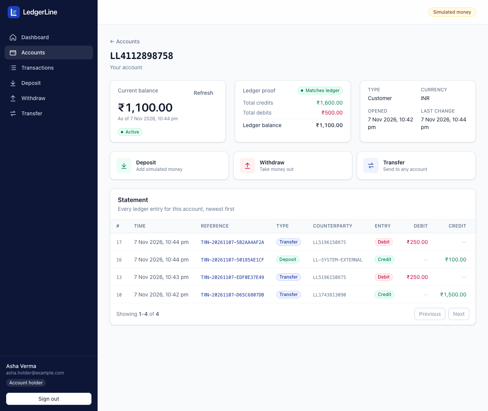 Statement with ledger proof |
| 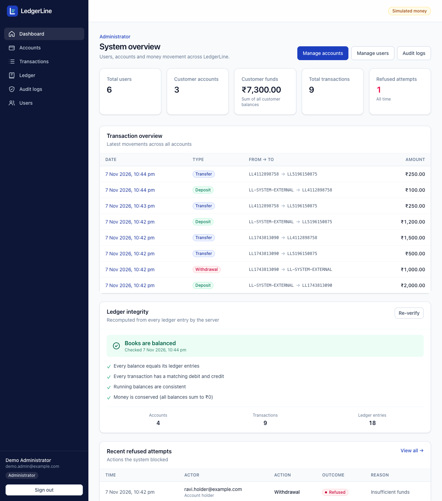 Administrator overview | 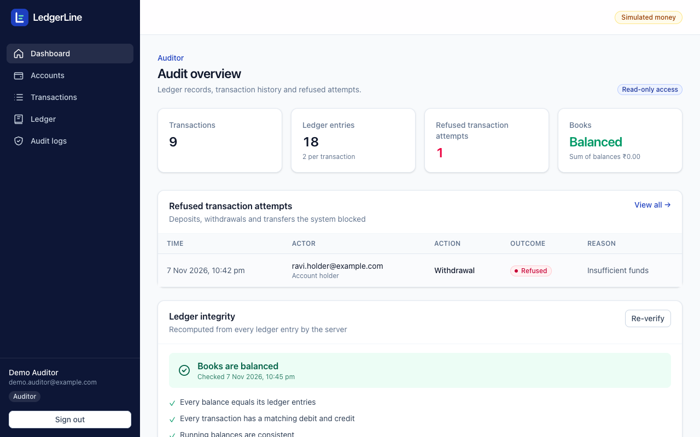 Auditor – read-only |
| 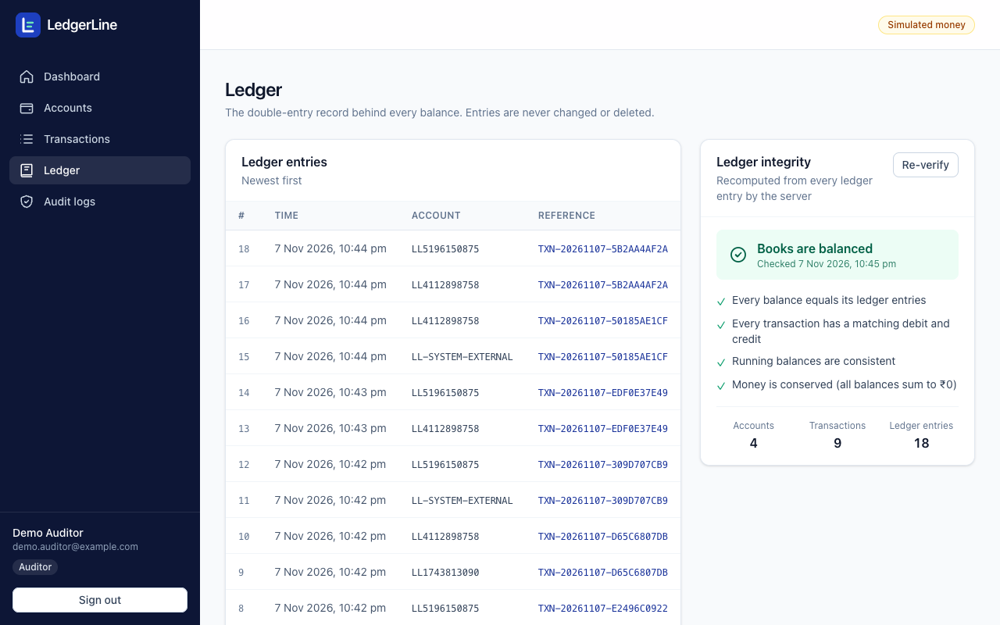 Ledger and integrity check | 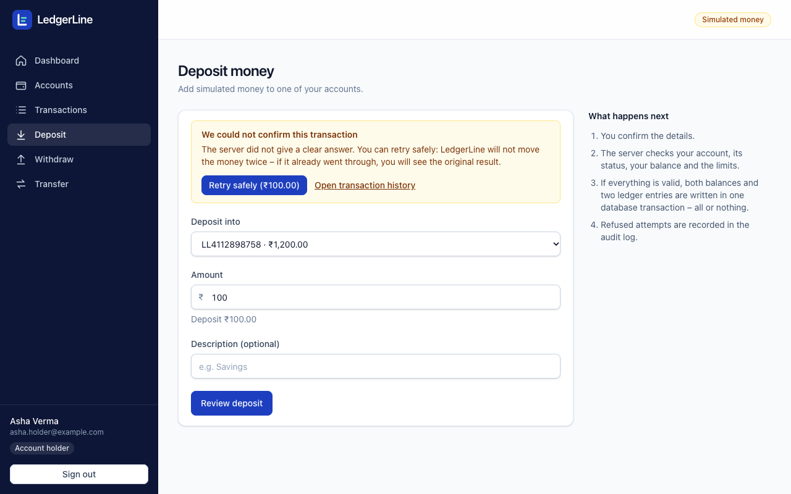 Lost response → Retry safely |
| 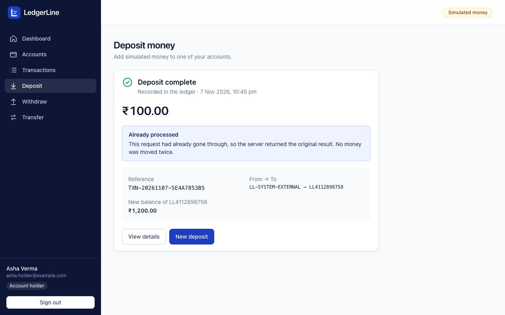 Retry returns the original – no double payment | 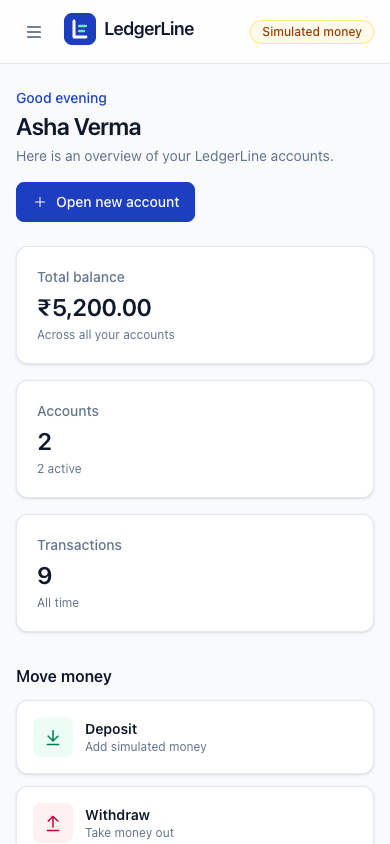 Mobile layout |

## 19. Limitations and future enhancements

**Known limitations** (details in [THREATS.md](THREATS.md)):
- The application's database role owns the tables and could disable triggers – production should use a separate DML-only role.
- Rate limits are per IP and kept in memory (not shared between server instances); no account lockout, CAPTCHA or MFA.
- A stolen session token works for up to 1 hour unless the user logs out; logout signs out all devices.
- Idempotency keys expire after 24 hours and are not cleaned up by a scheduled job.
- All deposits and withdrawals serialize on the single SYSTEM account row (throughput, not safety).
- INR only; per-transaction limits, no daily limits; no independent penetration test.

**Future enhancements:** separate database roles for migrations and runtime · Redis-backed rate limiting · MFA and per-device
sessions · scheduled cleanup of expired idempotency keys · daily limits and scheduled transfers · CSV/PDF statements ·
multi-currency with exchange rates · CI pipeline running all test suites on every push.

## 20. Project documents

| Document | Contents |
|---|---|
| [docs/API.md](docs/API.md) | API reference: every endpoint, request, real response, error codes |
| [THREATS.md](THREATS.md) | Threat model: 13 financial threats, protections, proving tests, accepted risks |
| [docs/SECURITY_AUDIT.md](docs/SECURITY_AUDIT.md) | Day 3 security audit with the actual result of each attack |
| [PROMPTS.md](PROMPTS.md) | AI usage log: prompts, what AI generated, what was wrong, how it was found and fixed |
| [frontend/README.md](frontend/README.md) | Frontend structure and scripts |
